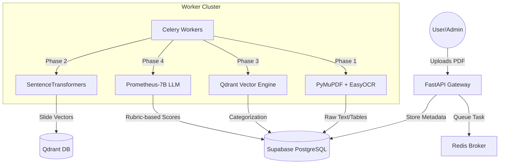

<div align="center">

# HackEval 🚀
### Intelligent Hackathon Submission Evaluation & Management System

[](https://github.com/Trivo121/hackeval/actions/workflows/ci.yml)
[](LICENSE)
[](CONTRIBUTING.md)
[](https://github.com/Trivo121/hackeval/graphs/contributors)
[](https://github.com/Trivo121/hackeval/issues)
[](https://github.com/Trivo121/hackeval)
[](https://fastapi.tiangolo.com)
[](https://react.dev)
[](https://www.python.org/)
[](https://docs.celeryq.dev/)

<p align="center">
  <b>An open-source, asynchronous AI pipeline to automate the evaluation, categorization, and grading of hackathon submissions with LLM-powered rubrics.</b>
</p>

[Explore Docs](#-table-of-contents) • [System Architecture](#️-system-architecture) • [Quickstart](#-quickstart--local-development) • [Contribute](#-contributing--open-for-prs) • [Maintainer](#-project-maintainer)

</div>

---

## 🌟 HackEval is Open Source — Looking for Contributors!

> [!IMPORTANT]
> **We are actively welcoming open-source contributors!** Whether you are fixing a typo, refactoring code, integrating a new LLM provider, polishing the UI, or adding tests — your Pull Request is warmly appreciated!

- 🎯 **Beginner Friendly**: We have tasks tagged for all experience levels.
- 🤝 **Mentorship & Fast Reviews**: PRs are reviewed swiftly by the maintainer.
- 💡 **Shape the Roadmap**: Have ideas for autonomous evaluation rubrics, agentic judges, or new integrations? We'd love your input!

👉 **[Jump straight to How to Contribute](#-contributing--open-for-prs)** or check out the full [CONTRIBUTING.md](CONTRIBUTING.md).

---

## 📖 Table of Contents

- [About HackEval](#-about-hackeval)
- [System Architecture](#️-system-architecture)
- [The 4-Phase AI Pipeline](#-the-backend-engine-a-4-phase-pipeline)
- [Infrastructure & AWS Deployment](#-infrastructure--aws-deployment)
- [Technology Stack](#️-technology-stack)
- [Quickstart & Local Development](#-quickstart--local-development)
  - [Prerequisites](#prerequisites)
  - [Backend Setup](#backend-setup)
  - [Frontend Setup](#frontend-setup)
  - [Docker Compose (Full-Stack)](#docker-compose-full-stack)
- [Contributing & Open for PRs](#-contributing--open-for-prs)
  - [Good First Issues & Areas to Contribute](#-good-first-issues--areas-to-contribute)
  - [Step-by-Step Guide to Raising a PR](#-step-by-step-guide-to-raising-a-pr)
- [Project Maintainer](#-project-maintainer)
- [Code of Conduct](#-code-of-conduct)
- [License](#-license)

---

## 💡 About HackEval

Evaluating hundreds of hackathon slide decks and pitch documents manually is exhausting, subjective, and slow. **HackEval** is a high-performance, asynchronous pipeline engineered to automate this pipeline end-to-end:

1. **Intelligent Text & Slide Extraction**: Handles native digital text as well as complex graphic layouts and scans.
2. **Semantic Vector Search**: Understands slide themes in high-dimensional vector space using SentenceTransformers and Qdrant.
3. **Problem Statement Matching**: Automatically clusters and classifies submissions to their correct problem track.
4. **AI-Driven Rubric Evaluation**: Uses fine-tuned evaluation LLMs (Prometheus-7B v2.0 via vLLM) to grade submissions against comprehensive rubrics and return transparent feedback with integer scores.

---

## 🏛️ System Architecture



---

## ⚙️ The Backend Engine: A 4-Phase Pipeline

### Phase 1: Intelligent Extraction
Unlike simple text scrapers, HackEval uses a hybrid extraction strategy:
- **Primary Engine**: `PyMuPDF` (`fitz`) for ultra-fast native text and table extraction.
- **Fallback Engine**: `EasyOCR` rendered via `PIL` for image-only slides or complex graphic layouts.
- **Output**: Structured markdown for tables, clean text blocks for content, and complexity scores.

### Phase 2: Semantic Vectorization
Transforms natural language into mathematical semantic representations:
- **Model**: `all-MiniLM-L6-v2` (`SentenceTransformers`).
- **Process**: Each slide is embedded into a 384-dimensional dense vector space.
- **Storage**: Vectors are indexed in **Qdrant** with HNSW indexing for sub-millisecond retrieval.

### Phase 3: Auto-Categorization
The system automatically maps submissions to the correct "Problem Statement":
- **Algorithm**: Cosine Similarity.
- **Logic**: Calculates the centroid of a submission's slide vectors and matches against track vectors.
- **Confidence**: Submissions below a confidence threshold are flagged for manual human review or tagged under "Open Innovation".

### Phase 4: AI-Driven Evaluation (The Judge)
The final stage uses a specialized LLM to grade submissions against custom rubrics:
- **Model**: `Prometheus-7B v2.0` (A SOTA evaluator model).
- **Inference**: Hosted on a high-throughput **vLLM** instance for parallel batch grading.
- **Logic**: The judge analyzes the extracted content, cross-references it with the problem statement rubric, and outputs actionable feedback + an integer score (1-5).

---

## 🖥️ Infrastructure & AWS Deployment

To run HackEval at scale in production, we recommend the following AWS configuration:

| Component | Role | AWS Instance | Rationale |
| :--- | :--- | :--- | :--- |
| **App Gateway** | FastAPI, Redis, Auth | `t3.large` | Burst-capable CPU for high API concurrency. |
| **Worker Node** | PDF Parsing & Embedding | `g4dn.xlarge` | NVIDIA T4 GPU accelerates OCR and SentenceTransformer batching. |
| **Vector DB** | Qdrant | `m5.large` | Optimized for memory-intensive HNSW indexing. |
| **AI Judge** | Prometheus-7B (vLLM) | **`g5.xlarge`** | 24GB A10G VRAM is required to serve the 7B model via vLLM with low latency. |

> [!NOTE]
> The current system is configured to connect to a production vLLM instance or local fallback LLM.

---

## 🛠️ Technology Stack

- **Backend**: FastAPI (Python 3.10+)
- **Task Queue & Broker**: Celery + Redis
- **Database & Authentication**: Supabase (PostgreSQL with Row Level Security)
- **Vector Database**: Qdrant
- **ML / AI**:
  - `SentenceTransformers` (`all-MiniLM-L6-v2`)
  - `Prometheus-7B v2.0` / `vLLM`
  - `PyMuPDF` + `EasyOCR` + `Docling`
- **Frontend**: React 18, Tailwind CSS, Lucide Icons

---

## 🚀 Quickstart & Local Development

### Prerequisites
- [Python 3.10+](https://www.python.org/downloads/)
- [Node.js 18+](https://nodejs.org/) & `npm`
- [Docker & Docker Compose](https://www.docker.com/) (for Redis and Qdrant)
- A free [Supabase](https://supabase.com) account

### Backend Setup

1. **Clone the repository**:
   ```bash
   git clone https://github.com/Trivo121/hackeval.git
   cd hackeval/backend
   ```

2. **Create a virtual environment**:
   ```bash
   # Windows (PowerShell)
   python -m venv venv
   .\venv\Scripts\Activate.ps1

   # Linux / macOS
   python3 -m venv venv
   source venv/bin/activate
   ```

3. **Install dependencies**:
   ```bash
   pip install -r requirements.txt
   ```

4. **Setup Environment Variables**:
   ```bash
   cp .env.example .env
   ```
   Fill in your `SUPABASE_URL`, `SUPABASE_ANON_KEY`, and `SUPABASE_SERVICE_KEY`.

5. **Start Redis**:
   ```bash
   docker run -d -p 6379:6379 --name hackeval_redis redis:7-alpine
   ```

6. **Run the API server**:
   ```bash
   uvicorn app.main:app --reload --port 8000
   ```
   Interactive Swagger documentation will be available at `http://localhost:8000/docs`.

7. **Run the Celery Worker** (in a separate terminal):
   ```bash
   celery -A app.celery_app worker --loglevel=info -Q extraction,embedding -P solo
   ```

### Frontend Setup

1. **Navigate to the frontend directory**:
   ```bash
   cd ../frontend
   ```

2. **Install dependencies**:
   ```bash
   npm install
   ```

3. **Configure environment**:
   ```bash
   cp .env.example .env
   ```
   Ensure `REACT_APP_API_URL=http://localhost:8000` and Supabase keys match your backend.

4. **Start the development server**:
   ```bash
   npm start
   ```
   The UI will open at `http://localhost:3000`.

### Docker Compose (Full-Stack)
You can also launch Redis, the API, and Celery workers together:
```bash
cd backend
docker-compose up --build
```

---

## 🤝 Contributing & Open for PRs

We love contributions! Whether you want to fix a minor issue, improve documentation, or propose a major new capability, you are welcome here.

### 💡 Good First Issues & Areas to Contribute

Looking for ideas to tackle? Here are some top areas:
- [ ] **Multi-Provider LLM Fallback**: Add support for OpenAI (`gpt-4o-mini`), Google Gemini (`gemini-1.5-flash`), Anthropic Claude, or Groq as plug-and-play evaluation alternatives when a local vLLM instance is unavailable.
- [ ] **Rubric Builder UI**: Create a visual rubric builder in the React frontend so organizers can customize evaluation criteria per hackathon track.
- [ ] **Export Options**: Add one-click export (CSV / PDF report) for project leaderboards and detailed scoring feedback.
- [ ] **Enhanced PDF Slide Parsing**: Improve extraction speed and visual diagram handling using Docling or advanced PyMuPDF heuristics.
- [ ] **Testing & CI/CD**: Add unit and integration tests (pytest for backend, Jest/Testing Library for React) and GitHub Actions workflow.
- [ ] **Dark / Light Theme Toggle**: Enhance the UI styling with accessible theme preferences.

### 📝 Step-by-Step Guide to Raising a PR

1. **Fork the Repo**: Click the **Fork** button at the top-right of [https://github.com/Trivo121/hackeval](https://github.com/Trivo121/hackeval).
2. **Clone your fork**:
   ```bash
   git clone https://github.com/<your-username>/hackeval.git
   cd hackeval
   ```
3. **Create a branch**:
   ```bash
   git checkout -b feat/my-new-feature
   # or
   git checkout -b fix/issue-description
   ```
4. **Make your changes & test**:
   - Verify that your code adheres to project standards.
   - Test both backend and frontend locally.
5. **Commit your changes**:
   ```bash
   git commit -m "feat: add Google Gemini fallback evaluator"
   ```
6. **Push to your fork**:
   ```bash
   git push origin feat/my-new-feature
   ```
7. **Submit a Pull Request**:
   - Go to [https://github.com/Trivo121/hackeval/pulls](https://github.com/Trivo121/hackeval/pulls).
   - Click **New Pull Request** and select your branch.
   - Complete the PR template checklist and submit!

For more detailed conventions, check out our [Contributing Guide](CONTRIBUTING.md).

---

## 👤 Project Maintainer

This project is actively maintained and led by:

| Maintainer | GitHub | Contact | Role |
| :--- | :--- | :--- | :--- |
| **Viswa** | [@Trivo121](https://github.com/Trivo121) | [`viswa225574@gmail.com`](mailto:viswa225574@gmail.com) | Lead Architect & Maintainer |

Feel free to connect, open an issue for questions, or discuss new features!

---

## 🛡️ Code of Conduct

To ensure a welcoming, inclusive, and harassment-free community, all contributors are expected to abide by our [Code of Conduct](CODE_OF_CONDUCT.md).

---

## 📄 License

This project is licensed under the **MIT License** — see the [LICENSE](LICENSE) file for details. You are free to use, modify, distribute, and contribute to this repository.

---

<div align="center">
  <b>Made with ❤️ by <a href="https://github.com/Trivo121">Trivo121</a> and the Open Source Community.</b><br>
  <i>⭐ If you find HackEval useful, don't forget to give it a star on GitHub!</i>
</div>
